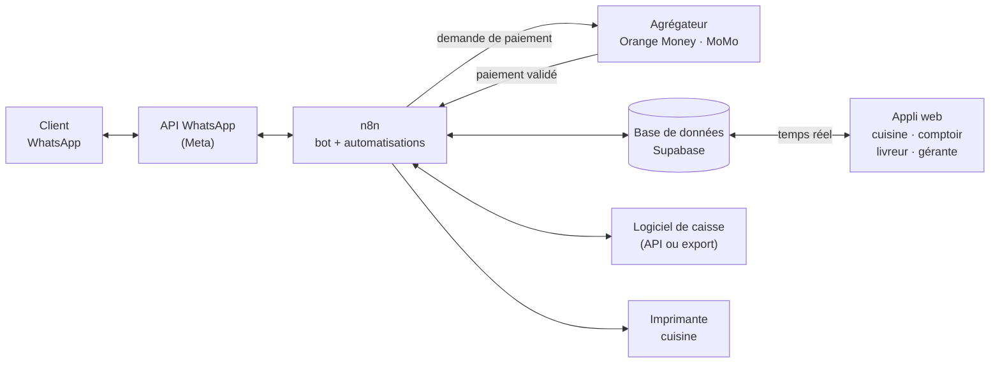

# C Pizza — Logiciel de commandes « 360 » — Cahier des charges — 24 octobre 2026

Document de travail interne. Il sert à cadrer le projet avant le prochain rendez-vous avec la gérante, à estimer le travail et à fixer le prix.

C Pizza est au Cameroun : les clients paient par Orange Money ou MTN MoMo, toujours avant la préparation : il n'y a pas de paiement à la livraison. Les montants sont en FCFA.

## Ce que la gérante veut

Un seul outil pour tous les points C Pizza. Il prend la commande sur WhatsApp, vérifie le paiement tout seul, envoie la commande en cuisine, puis la passe au livreur ou à l'hôtesse. Il calcule les frais de livraison, se branche sur leur logiciel de caisse et garde toutes les données dans une base qu'ils peuvent utiliser.

**L'objectif à vendre : plus aucune personne ne sert d'intermédiaire entre le client, la cuisine et le livreur.**

## Aujourd'hui et demain

| Étape | Aujourd'hui | Avec le logiciel |
|---|---|---|
| Prise de commande | Bot WhatsApp (déjà fait) | Le même bot : rien ne change pour le client |
| Choix du point de vente | Le bot envoie la commande sur le WhatsApp du site | La commande est enregistrée dans la base et attribuée au bon site automatiquement |
| Vérification du paiement | **Une personne vérifie le paiement Orange Money ou MoMo, puis prévient le bot** | Le client valide le paiement sur son téléphone et l'opérateur prévient le logiciel en quelques secondes |
| Confirmation au client | Envoyée quand la personne a validé | Envoyée automatiquement dès que le paiement est reçu |
| Envoi en cuisine | **Une hôtesse porte la commande en cuisine** | La commande s'affiche sur l'écran cuisine et le ticket s'imprime |
| Livreur ou service sur place | À l'oral, à la main | La commande est proposée aux livreurs du site sur leur téléphone, ou affichée au comptoir |
| Suivi pour le client | Rien | Messages automatiques : en préparation, en route, livrée, prête au comptoir |
| Chiffres | Rien | Tableau de bord de tous les sites |

## Le parcours d'une commande

1. Le client écrit sur WhatsApp. Le bot prend la commande : produits, tailles, suppléments, mode (livraison, à emporter, sur place), quartier, point de repère et localisation partagée, heure souhaitée.
2. Le logiciel choisit le site. En livraison, c'est le site ouvert qui livre ce quartier. À emporter ou sur place, le client choisit parmi les sites ouverts.
3. Le logiciel calcule le total : produits, frais de livraison, remises, minimum de commande. Il donne aussi le délai estimé.
4. Le bot envoie le récapitulatif et demande : « Orange Money ou MoMo ? »
5. Le client reçoit sur son téléphone une demande de paiement de C Pizza et la valide avec son code secret. L'opérateur prévient le logiciel et la commande passe « payée ».
6. Le client reçoit sa confirmation avec son numéro de commande et l'heure estimée.
7. La commande s'affiche sur l'écran cuisine du site, avec une alerte sonore, et le ticket s'imprime.
8. La cuisine appuie sur « Commencer », puis sur « Prête ».
9. Pour une livraison, la commande est proposée aux livreurs du site. Le premier qui l'accepte la prend, appuie sur « Parti » (le client est prévenu qu'elle est en route), puis sur « Livrée ».
10. À emporter ou sur place, la commande passe sur l'écran du comptoir et le client reçoit « Votre commande n° 42 est prête ».
11. La commande est envoyée dans le logiciel de caisse et comptée dans les chiffres.

### Les statuts d'une commande

Chaque changement de statut est noté dans un journal : qui l'a fait et à quelle heure. On sait toujours où en est une commande, et on peut mesurer les temps de préparation et de livraison.

| Statut | Qui le déclenche | Message au client |
|---|---|---|
| `attente_paiement` | Le bot, quand le client a choisi Orange Money ou MoMo | Récapitulatif + « Validez le paiement sur votre téléphone » |
| `payee` | L'opérateur, par l'agrégateur de paiement (automatique) | Confirmation, numéro de commande, heure estimée |
| `en_preparation` | La cuisine (« Commencer ») | « Votre commande est en préparation » |
| `prete` | La cuisine (« Prête ») | À emporter ou sur place : « Votre commande n° 42 est prête » |
| `en_livraison` | Le livreur (« Parti ») | « Votre livreur est en route », avec son prénom et son numéro |
| `livree` / `remise` | Le livreur ou le comptoir | Remerciement (et demande d'avis Google, en option) |
| `annulee` | Le logiciel (paiement non reçu) ou une personne de l'équipe | Message d'annulation et remboursement si besoin |

## Les modules

### 1. Le bot WhatsApp (déjà fait, à rebrancher)

- Le bot n'envoie plus la commande sur le WhatsApp du site : il l'écrit dans la base. Le site la voit sur ses écrans.
- **L'IA sert à comprendre le client, pas à compter.** Les prix, les frais, les totaux et les délais sont toujours calculés par le logiciel à partir de la base. Le bot demande le montant au logiciel et le répète au client. On évite ainsi les erreurs de prix.
- **L'adresse :** le bot demande le quartier (il sert à calculer les frais), un point de repère (« après la pharmacie du carrefour ») et la localisation partagée sur WhatsApp, qui donne la position GPS au livreur. Pour un client qui revient : « Même adresse que la dernière fois ? »
- Si le bot ne comprend pas ou que le client s'énerve, la conversation passe à l'équipe du site.
- Recommandé : **un seul numéro WhatsApp pour toute l'enseigne.** Le logiciel répartit les commandes entre les sites, et le client n'a pas à savoir quel site le livre.
- Ce qu'il faut pour l'API officielle de WhatsApp est détaillé plus bas.

### 2. Le paiement Orange Money et MoMo vérifié automatiquement

C'est la priorité : c'est ce qui bloque l'automatisation aujourd'hui.

**Le principe :** le logiciel envoie une demande de paiement sur le téléphone du client, qui la valide avec son code secret. C'est l'opérateur qui confirme le paiement au logiciel. Personne ne regarde plus un SMS ou une capture d'écran.

**Côté client :**

1. Le bot demande « Orange Money ou MoMo ? » et le numéro à débiter (par défaut, son numéro WhatsApp).
2. Le client reçoit sur son téléphone la demande : « Confirmez le paiement de 7 500 FCFA à C Pizza ». Il tape son code secret. S'il ne voit rien s'afficher, le bot lui donne le code court à composer pour valider (il dépend de l'opérateur et de l'agrégateur choisi).
3. Dès que le paiement est validé, la commande passe « payée » et part en cuisine.

**Deux façons de se brancher sur Orange Money et MoMo :**

| | Par un agrégateur (NotchPay, CinetPay, Campay, Monetbil…) | En direct avec Orange Cameroun et MTN Cameroon |
|---|---|---|
| Branchement | Un seul pour les deux opérateurs | Deux contrats et deux branchements |
| Délai | Plus court (à confirmer avec l'agrégateur) | 3 à 6 mois annoncés : dossier, vérification de l'entreprise, contrat, certification |
| Commission annoncée | 1,5 à 3 % par paiement | 1 à 2 % par paiement |
| L'argent | Collecté par l'agrégateur puis reversé au restaurant : **délai et frais de reversement à demander** | Directement sur les comptes marchands du restaurant |
| Notre choix | **Pour démarrer** | Plus tard, si le volume le justifie |

Les commissions viennent d'articles de prestataires. **Il faut demander une grille écrite et datée** à 2 ou 3 agrégateurs avant de chiffrer l'offre.

**Solution de transition (si le compte chez l'agrégateur tarde) :** le restaurant garde son numéro marchand Orange Money ou MoMo. Un petit téléphone Android, avec la puce de ce numéro, transfère au logiciel chaque SMS de confirmation de paiement. Le logiciel lit le montant, le numéro qui a payé et la référence de la transaction, puis retrouve la commande qui attend ce montant. Si le client a payé depuis un autre numéro, le bot lui demande la référence de la transaction. Cette solution marche, mais elle dépend d'un téléphone allumé et du format des SMS : ce n'est pas la solution finale.

**Pas de paiement à la livraison :** toutes les commandes WhatsApp sont payées par Orange Money ou MoMo avant d'être préparées. La cuisine et les livreurs ne voient que des commandes payées, et le livreur n'a rien à encaisser.

**Règles à programmer :**

- Pas de validation au bout de 5 minutes, ou solde insuffisant : le bot propose de renvoyer la demande ou de changer de numéro ou d'opérateur. Sans paiement au bout de 20 minutes, la commande est annulée.
- **Une capture d'écran ou un SMS transféré par le client ne valent jamais paiement.** Seule la confirmation de l'opérateur compte. Cela supprime les fraudes aux fausses captures.
- Paiement reçu après l'annulation : remboursement par l'agrégateur sur le numéro du client, ou commande réactivée si le site peut encore la préparer.
- Double paiement : le deuxième est remboursé automatiquement.
- Réseau de l'opérateur en panne : le bot propose de payer avec l'autre opérateur, ou de réessayer un peu plus tard.

### 3. L'envoi en cuisine

- **Écran cuisine** sur une tablette dans chaque site. Les commandes payées s'affichent toutes seules avec une alerte sonore, dans l'ordre de l'heure à laquelle elles doivent partir.
- Deux boutons : « Commencer » et « Prête ». Un chronomètre sur chaque commande, qui change de couleur en cas de retard.
- **Ticket imprimé automatiquement** pour les cuisines qui veulent du papier : imprimante thermique connectée au réseau, qui imprime dès que la commande est payée.
- **Coupures de courant et de réseau :** tablette sur batterie, imprimante et routeur 4G sur onduleur. Les commandes sont gardées en ligne, pas dans le site : elles s'affichent dès le retour du réseau. Si l'écran d'un site est déconnecté plus de 2 minutes, la gérante est alertée et les nouvelles commandes sont aussi envoyées par WhatsApp au responsable du site.
- **Rupture :** un bouton « Produit épuisé ». Le bot ne propose plus ce produit dans ce site jusqu'à ce qu'il soit remis en vente.
- **Capacité :** un nombre maximum de pizzas par quart d'heure et par site. Au-delà, le bot annonce un délai plus long ou propose un autre site.
- **Mode pause :** la cuisine est débordée, elle appuie sur « Pause » et le bot arrête de prendre des commandes pour ce site pendant le temps choisi.

### 4. De la cuisine au livreur ou à l'hôtesse

**Livraison :**

- Quand la commande passe « Prête » (ou dès « Commencer », pour que le livreur se prépare), elle est proposée aux livreurs du site sur leur téléphone. Le premier qui appuie sur « Je prends » l'a.
- L'appli livreur est une page web légère : elle marche sur un petit Android et consomme peu de données.
- La fiche du livreur contient le quartier, le point de repère, un bouton pour ouvrir la position du client dans Google Maps, le téléphone du client et les consignes. Il n'y a rien à encaisser : la commande est déjà payée.
- Boutons « Parti », « Livrée » et « Client injoignable ».
- Si personne n'accepte en 5 minutes, le responsable du site est alerté.
- Plus tard : regrouper deux commandes du même quartier dans une même course.

**Sur place ou à emporter :**

- Écran du comptoir : les commandes prêtes avec leur numéro, le nom du client et, sur place, le numéro de table.
- Le client reçoit « Votre commande n° 42 est prête ». Rappel automatique si une commande à emporter n'est pas retirée au bout de 15 minutes.

### 5. Le calcul de la livraison

- **Les frais se calculent par quartier**, comme les clients en ont l'habitude. Chaque site a la liste des quartiers qu'il livre, avec un prix par quartier. Par exemple : 500 FCFA pour les quartiers proches, 1 000 FCFA plus loin, 1 500 FCFA en périphérie.
- La localisation partagée sert à vérifier le quartier et à guider le livreur. Si le client est entre deux quartiers, c'est le prix le plus proche de sa position GPS qui s'applique.
- Pour chaque quartier : un minimum de commande, et la livraison offerte au-delà d'un montant si la gérante le souhaite.
- Quartier non livré : le bot propose la commande à emporter dans le site le plus proche.
- Un même quartier peut être livré par deux sites : le logiciel choisit celui qui est ouvert et le moins chargé.
- **Délai annoncé** = commandes déjà en attente en cuisine + temps de préparation + temps de trajet moyen vers ce quartier (mesuré sur les livraisons passées).

### 6. L'espace de la gérante

- **Carte et prix :** les mêmes pour tous les sites, ou propres à un site. Tailles, suppléments, menus, promotions.
- **Sites :** horaires, fermetures exceptionnelles, mode pause, capacité.
- **Livraison :** quartiers livrés par chaque site, frais, minimums.
- **Équipe :** cuisine, comptoir, livreurs, responsables. Chacun ne voit que son site, la gérante voit tout.
- **Suivi en direct** de toutes les commandes de tous les sites.
- **Caisse du jour :** ce qui a été payé par Orange Money et par MoMo, site par site.
- **Chiffres** par site et par jour : chiffre d'affaires, nombre de commandes, panier moyen, répartition livraison, à emporter et sur place, temps moyen de préparation et de livraison, commandes annulées et pourquoi, produits les plus vendus, quartiers qui commandent le plus, clients qui reviennent.
- **Fichier clients :** numéro, quartier, nombre de commandes, dernière commande, accord pour recevoir des offres. Plus tard : envoi de promotions par WhatsApp aux clients qui ont donné leur accord.
- **Exports** Excel ou CSV pour la comptabilité.

### 7. La connexion au logiciel de caisse

Les commandes WhatsApp doivent apparaître dans le logiciel de gestion, pour que le chiffre d'affaires et les stocks soient au même endroit. Il faut aussi demander à leur comptable ce que l'administration fiscale (DGI) demande pour l'enregistrement des ventes.

Trois cas, selon leur logiciel :

| Cas | Ce qu'on fait |
|---|---|
| **Leur logiciel a une API** (c'est le cas par exemple de Loyverse et d'Odoo, très utilisés en Afrique) | Connecteur direct : les commandes arrivent dans leur logiciel et la carte vient de leur logiciel |
| **Leur logiciel n'a pas d'API** | Export quotidien des ventes à importer dans leur logiciel, et notre logiciel devient l'endroit où l'on gère la carte |
| **Pas de vrai logiciel** (cahier, Excel) | Notre logiciel devient leur outil de gestion des commandes, avec les exports pour la comptabilité |

Ce qu'on synchronise :

- **vers leur logiciel :** les commandes et leurs paiements ;
- **depuis leur logiciel :** la carte, les prix et les ruptures, pour qu'un prix ne se change qu'à un seul endroit.

**Première question à poser :** le nom exact de leur logiciel de caisse et de gestion.

### 8. La base de données

Une seule base pour tous les sites (PostgreSQL). Chaque membre de l'équipe ne voit que les données de son site.

| Table | Ce qu'elle contient |
|---|---|
| `sites` | nom, adresse, position GPS, horaires, statut (ouvert, pause, fermé), capacité par quart d'heure |
| `quartiers` | nom, ville, position approximative |
| `quartiers_sites` | site, quartier, frais de livraison, minimum de commande, montant à partir duquel la livraison est offerte, temps de trajet moyen |
| `produits`, `options` | carte, tailles, suppléments, prix de base |
| `produits_sites` | prix propre à un site, rupture |
| `clients` | numéro WhatsApp, nom, accord pour les offres, nombre de commandes |
| `adresses` | client, quartier, point de repère, position GPS, consignes |
| `commandes` | numéro, site, client, mode, statut, sous-total, frais de livraison, remise, total, heure souhaitée, heure estimée |
| `lignes_commande` | produit, options, quantité, prix au moment de la commande |
| `paiements` | commande, opérateur (Orange Money ou MoMo), numéro débité, agrégateur, référence de transaction, montant, statut, date, remboursement |
| `evenements` | commande, ancien et nouveau statut, qui, quand |
| `livraisons` | commande, livreur, heure d'acceptation, de départ et de livraison |
| `equipe` | personne, rôle (cuisine, comptoir, livreur, responsable, gérante), sites |

Les données appartiennent au restaurant. On peut les exporter à tout moment et les brancher sur Excel, Google Sheets ou un outil de tableaux de bord.

## Ce qu'il faut pour l'API WhatsApp

Pour un produit vendu à une enseigne de plusieurs sites, il faut l'**API officielle de WhatsApp** (WhatsApp Business Platform, de Meta). Une connexion non officielle, de type WhatsApp Web, peut faire bloquer le numéro du jour au lendemain. **Première chose à vérifier : par quoi passe le bot actuel.**

**Côté C Pizza (à préparer avec la gérante) :**

| Élément | Détail |
|---|---|
| **Un compte Meta Business** au nom de C Pizza | Créé sur business.facebook.com. Le compte appartient au restaurant, et on y est ajouté comme administrateur. Si un jour on arrête de travailler ensemble, le restaurant garde son numéro et son historique |
| **La vérification de l'entreprise par Meta** | Meta demande des documents qui prouvent le nom légal et l'adresse : au Cameroun, le RCCM, la carte de contribuable (NIU) et un justificatif d'adresse au nom de l'entreprise. Un site internet ou une page au nom de C Pizza aide. On peut démarrer avant la vérification, avec des limites (voir plus bas) |
| **Un numéro de téléphone** | Il doit pouvoir recevoir un SMS ou un appel pour le code de validation. Deux possibilités pour le numéro que les clients connaissent déjà : le passer sur l'API (il ne pourra plus servir dans l'application WhatsApp Business), ou l'utiliser à la fois dans l'application et dans l'API (« coexistence »). La coexistence est annoncée dans la plupart des pays, mais **je n'ai pas pu confirmer qu'elle est ouverte au Cameroun : à tester à l'inscription** |
| **Le nom affiché** | « C Pizza », validé par Meta. Il doit correspondre au nom de l'entreprise |
| **Une carte de paiement pour Meta** | Une carte Visa ou Mastercard qui accepte les paiements en ligne (carte bancaire ou carte virtuelle), pour payer les messages. Sans elle, les messages s'arrêtent une fois les messages gratuits épuisés |

**Côté technique (notre travail) :**

- Une application sur le compte développeur de Meta, reliée au compte WhatsApp de C Pizza, avec l'API Cloud : elle est hébergée par Meta, sans abonnement à un intermédiaire.
- Un jeton d'accès permanent, créé avec un « utilisateur système » du compte Meta Business.
- Une adresse sécurisée (HTTPS) sur notre serveur n8n, où Meta envoie les messages des clients. n8n a déjà les blocs WhatsApp pour recevoir et envoyer.
- **Des modèles de messages validés par Meta**, pour tout message que le restaurant envoie en premier ou plus de 24 heures après le dernier message du client : « commande confirmée », « en route », « livrée », messages aux livreurs. Les promotions passent par des modèles « marketing », envoyés seulement aux clients qui ont donné leur accord.

**Les règles de Meta à respecter :**

- Depuis le 15 janvier 2026, Meta interdit sur l'API les assistants d'IA « généralistes » (de type ChatGPT). Un bot qui prend les commandes et suit les livraisons d'un restaurant reste autorisé. Le bot doit donc rester sur la carte, les commandes et le suivi, et passer la main à l'équipe pour le reste.
- Avant la vérification, le restaurant ne peut écrire en premier qu'à un nombre limité de clients par jour (250 selon les règles connues). Les réponses aux clients qui écrivent en premier ne sont pas limitées : pour la prise de commande, ce n'est pas bloquant.

**Combien ça coûte (Meta) :**

- Depuis le 1ᵉʳ octobre 2026, Meta fait payer aussi les réponses envoyées dans les 24 heures qui suivent le message du client. Selon plusieurs prestataires, chaque numéro garde 1 000 réponses gratuites par mois. Les messages des clients restent gratuits.
- Au Cameroun, les grilles de prestataires donnent environ 0,004 $ par message de service ou de suivi (environ 2 à 3 FCFA) et environ 0,0225 $ par message marketing (environ 12 à 15 FCFA). **À vérifier sur la grille officielle de Meta.**
- Une commande, c'est environ 10 à 15 messages envoyés par le bot : de l'ordre de **25 à 45 FCFA par commande** au-delà des messages gratuits.

**Délai :** l'inscription prend une journée. La vérification de l'entreprise par Meta peut prendre de quelques jours à quelques semaines : **à lancer dès la signature.**

## Architecture technique

- **n8n** : on l'utilise déjà. Il est fait pour brancher les services entre eux : WhatsApp, Orange Money et MoMo, caisse, imprimante. On ne s'en sert pas pour les écrans.
- **Supabase** : la base de données, avec trois choses dont on a besoin : le temps réel (les écrans se mettent à jour seuls dès qu'une commande change de statut), les comptes et les droits par site.
- **Une appli web installable** sur tablette et téléphone, sans passer par le Play Store. Une seule appli avec quatre écrans selon le rôle : cuisine, comptoir, livreur, gérante. Elle doit rester légère pour les petits Android et le réseau 3G.
- **Règle de base : la base de données est la seule référence.** Le bot, les écrans et la caisse lisent et écrivent au même endroit. Aucune information ne circule seulement par message WhatsApp entre membres de l'équipe.

## Cas particuliers à prévoir

| Situation | Ce que fait le logiciel |
|---|---|
| Le client ne valide pas la demande de paiement | Au bout de 5 minutes, le bot propose de renvoyer la demande ou de changer de numéro ou d'opérateur. Annulation à 20 minutes |
| Solde insuffisant | Même chose |
| Le client envoie une capture d'écran de paiement | Le bot explique que le paiement est confirmé automatiquement. La capture ne vaut pas paiement |
| Réseau Orange ou MTN en panne | Le bot propose de payer avec l'autre opérateur, ou de réessayer plus tard |
| Paiement reçu après l'annulation | Remboursement sur le numéro du client, ou commande réactivée si le site peut la préparer |
| Le client paie deux fois | Le deuxième paiement est remboursé automatiquement |
| Quartier non livré | Proposition de commande à emporter dans le site le plus proche |
| Site fermé ou en pause | Proposition d'un autre site, ou d'une commande pour plus tard |
| Cuisine saturée | Délai annoncé plus long, ou proposition d'un autre site |
| Produit en rupture après la commande | La cuisine appuie sur « Remplacer » ; le bot propose un autre produit ou rembourse la différence |
| Le client veut modifier ou annuler | Possible tant que la commande n'est pas en préparation. Après, la conversation passe à l'équipe |
| Aucun livreur n'accepte en 5 minutes | Alerte au responsable du site |
| Livraison en retard | Message d'excuse automatique, et code promo en option |
| Client injoignable à la livraison | Le livreur appuie sur « Client injoignable », le bot écrit au client, la consigne est fixée par la gérante |
| Commande à emporter non retirée | Rappel au client après 15 minutes |
| Le bot ne comprend pas | La conversation passe à l'équipe du site |
| Coupure de courant ou de réseau dans un site | Tablette sur batterie, routeur sur onduleur. Si l'écran reste déconnecté plus de 2 minutes : alerte à la gérante et commandes envoyées par WhatsApp au responsable du site |

## Plan de réalisation

Les durées sont des estimations de développement pour une personne. Elles sont à confirmer après les réponses de la gérante, surtout pour la caisse.

**Dès la signature, lancer en parallèle les deux démarches qui ne dépendent pas de nous :** l'ouverture du compte chez l'agrégateur de paiement et la vérification de l'entreprise par Meta. Elles peuvent prendre plusieurs semaines.

| Phase | Contenu | Durée estimée | Ce que gagne le restaurant |
|---|---|---|---|
| **1. Zéro vérification** (un site pilote) | Base de données, bot rebranché sur la base, paiement Orange Money et MoMo vérifié automatiquement, écran cuisine, ticket imprimé, messages automatiques au client | 2 à 3 semaines | Plus de vérification de paiement à la main, plus d'hôtesse qui porte les commandes en cuisine |
| **2. Tous les sites et la livraison** | Choix du site selon le quartier, frais de livraison, appli livreur, écran comptoir, déploiement sur tous les sites | 2 à 3 semaines | Les commandes vont seules au bon site et au bon livreur |
| **3. Pilotage** | Connexion à la caisse, espace gérante complet, caisse du jour, chiffres, exports, ruptures, capacité, mode pause | 2 à 4 semaines | La gérante pilote tous les sites depuis un seul écran |

Si le compte chez l'agrégateur n'est pas prêt à la fin de la phase 1, on démarre avec la solution de transition (lecture des SMS du numéro marchand).

Le pilote sur un site sert de preuve : on mesure le temps gagné et les erreurs évitées avant de passer à tous les sites.

## Coûts techniques chaque mois (pour fixer le prix)

Ordres de grandeur, tous à vérifier avant de chiffrer l'offre. Pour les conversions : 1 € = 655,957 FCFA.

| Poste | Coût | Qui paie |
|---|---|---|
| Hébergement de n8n | Environ 3 000 à 16 000 FCFA/mois (serveur) | Nous, inclus dans l'abonnement |
| Supabase | Gratuit pour tester, 25 $ par mois en production (environ 15 000 FCFA) | Nous, inclus dans l'abonnement |
| Messages WhatsApp (Meta) | De l'ordre de 25 à 45 FCFA par commande au-delà des 1 000 réponses gratuites par mois (voir la section WhatsApp) | À décider : inclus jusqu'à un volume, ou refacturé |
| Commission Orange Money et MoMo | 1,5 à 3 % de chaque paiement par un agrégateur, plus les frais de reversement | Le restaurant, directement à l'agrégateur |
| Téléphone de transition (si besoin) | Un petit Android et la puce du numéro marchand | Le restaurant, une seule fois |
| Matériel par site | Une tablette pour la cuisine, une imprimante thermique réseau, un routeur 4G, un onduleur ; un smartphone par livreur | Le restaurant, une seule fois |

## Questions à poser à la gérante

**Les sites**
- Combien de points C Pizza, dans quelles villes et quels quartiers ? Combien d'ouvertures prévues ?
- Même carte et mêmes prix partout ?
- Horaires de chaque site ?
- Livraison, à emporter, sur place : quelle part pour chacun ?

**Les commandes**
- Combien de commandes WhatsApp par jour et par site, et aux heures de pointe ?
- Commandent-ils aussi par téléphone, sur Facebook, sur une plateforme de livraison ? Faut-il tout réunir au même endroit ?
- Un seul numéro WhatsApp pour l'enseigne, ou un par site ?
- Combien de temps pour préparer une commande ? Combien de pizzas un four peut-il sortir par quart d'heure ?

**Le paiement**
- Quelle part Orange Money, quelle part MoMo ?
- Ont-ils des comptes marchands Orange Money et MoMo ? Un par site ou un pour l'enseigne ?
- Comment la vérification se fait-elle aujourd'hui (SMS, capture d'écran, appli) ? Ont-ils déjà eu des fausses captures ?
- Où doit arriver l'argent : compte marchand, compte bancaire ?
- Qui fait les remboursements aujourd'hui ?

**La livraison**
- Livreurs salariés ou à la course ? À moto ? Combien par site ? Ont-ils un smartphone ?
- Quartiers livrés par chaque site, et prix actuels par quartier ?
- Minimum de commande, livraison offerte à partir d'un montant ?

**La caisse et les données**
- Nom exact du logiciel de caisse et de gestion. Est-il le même dans tous les sites ?
- Ont-ils un comptable à qui poser la question des obligations fiscales ?
- Quels chiffres regardent-ils aujourd'hui, et lesquels leur manquent ?

**Le matériel**
- Y a-t-il une imprimante en cuisine ? Une tablette ? Le wifi ou la 4G passent-ils bien en cuisine ?
- Ont-ils un groupe électrogène ou un onduleur ? Les coupures sont-elles fréquentes ?

**WhatsApp**
- Par quel outil passe le bot actuel (API officielle ou connexion non officielle) ? Qui l'a fait, et sur quel compte ?
- Ont-ils déjà un compte Meta Business, une page Facebook, un site internet ?
- Peuvent-ils fournir le RCCM, la carte de contribuable et un justificatif d'adresse pour la vérification Meta ?
- Ont-ils une carte Visa ou Mastercard qui paie en ligne ?

## Prochaines étapes

1. Rendez-vous avec la gérante pour les questions ci-dessus.
2. Demander les grilles de prix écrites de 2 ou 3 agrégateurs (NotchPay, CinetPay, Campay…), avec les frais de reversement et les délais d'ouverture du compte.
3. Fixer le prix avec le skill `pricing-strategy` (mise en place par phase, abonnement par site, en FCFA) et noter l'offre dans `offre-s2l/registre-offres.md`.
4. Faire une maquette cliquable de l'écran cuisine et de l'appli livreur pour la démo.
