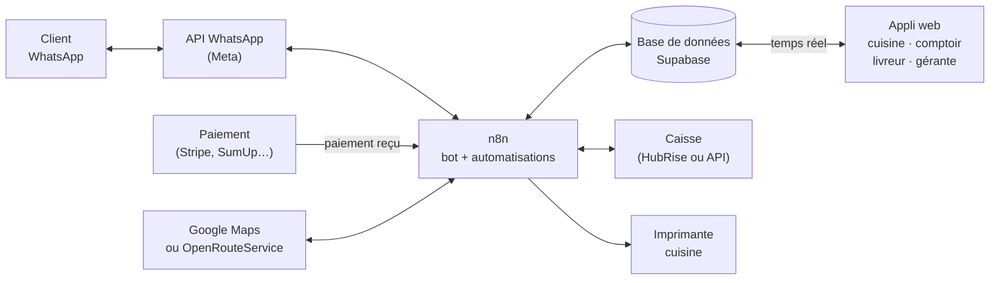

# C Pizza — Logiciel de commandes « 360 » — Cahier des charges — 24 octobre 2026

Document de travail interne. Il sert à cadrer le projet avant le prochain rendez-vous avec la gérante, à estimer le travail et à fixer le prix.

## Ce que la gérante veut

Un seul outil pour tous les points C Pizza. Il prend la commande sur WhatsApp, vérifie le paiement tout seul, envoie la commande en cuisine, puis la passe au livreur ou à l'hôtesse. Il calcule les frais de livraison, se branche sur leur logiciel de caisse et garde toutes les données dans une base qu'ils peuvent utiliser.

**L'objectif à vendre : plus aucune personne ne sert d'intermédiaire entre le client, la cuisine et le livreur.**

## Aujourd'hui et demain

| Étape | Aujourd'hui | Avec le logiciel |
|---|---|---|
| Prise de commande | Bot WhatsApp (déjà fait) | Le même bot : rien ne change pour le client |
| Choix du point de vente | Le bot envoie la commande sur le WhatsApp du site | La commande est enregistrée dans la base et attribuée au bon site automatiquement |
| Vérification du paiement | **Une personne vérifie, puis prévient le bot** | Le prestataire de paiement prévient le logiciel en quelques secondes |
| Confirmation au client | Envoyée quand la personne a validé | Envoyée automatiquement dès que le paiement est reçu |
| Envoi en cuisine | **Une hôtesse porte la commande en cuisine** | La commande s'affiche sur l'écran cuisine et le ticket s'imprime |
| Livreur ou service sur place | À l'oral, à la main | La commande est proposée aux livreurs du site sur leur téléphone, ou affichée au comptoir |
| Suivi pour le client | Rien | Messages automatiques : en préparation, en route, livrée, prête au comptoir |
| Chiffres | Rien | Tableau de bord de tous les sites |

## Le parcours d'une commande

1. Le client écrit sur WhatsApp. Le bot prend la commande : produits, tailles, suppléments, mode (livraison, à emporter, sur place), adresse ou localisation partagée, heure souhaitée.
2. Le logiciel choisit le site. En livraison, c'est le site ouvert le plus proche qui livre cette adresse. À emporter ou sur place, le client choisit parmi les sites ouverts.
3. Le logiciel calcule le total : produits, frais de livraison, remises, minimum de commande. Il donne aussi le délai estimé.
4. Le bot envoie le récapitulatif et un lien de paiement propre à cette commande.
5. Le client paie. Le prestataire de paiement prévient le logiciel et la commande passe « payée ».
6. Le client reçoit sa confirmation avec son numéro de commande et l'heure estimée.
7. La commande s'affiche sur l'écran cuisine du site, avec une alerte sonore, et le ticket s'imprime.
8. La cuisine appuie sur « Commencer », puis sur « Prête ».
9. Pour une livraison, la commande est proposée aux livreurs du site. Le premier qui l'accepte la prend, appuie sur « Parti » (le client est prévenu qu'elle est en route), puis sur « Livrée ».
10. À emporter ou sur place, la commande passe sur l'écran du comptoir et le client reçoit « Votre commande n° 42 est prête ».
11. La commande est envoyée dans le logiciel de caisse et comptée dans les chiffres.

### Les statuts d'une commande

Chaque changement de statut est noté dans un journal : qui l'a fait et à quelle heure. On sait toujours où en est une commande, et on peut mesurer les temps de préparation et de livraison.

| Statut | Qui le déclenche | Message au client |
|---|---|---|
| `attente_paiement` | Le bot, quand le client valide son panier | Récapitulatif + lien de paiement |
| `payee` | Le prestataire de paiement (automatique) | Confirmation, numéro de commande, heure estimée |
| `a_encaisser` | Le bot, si le client paie à la livraison ou au comptoir | Confirmation avec le montant à prévoir |
| `en_preparation` | La cuisine (« Commencer ») | « Votre commande est en préparation » |
| `prete` | La cuisine (« Prête ») | À emporter ou sur place : « Votre commande n° 42 est prête » |
| `en_livraison` | Le livreur (« Parti ») | « Votre livreur est en route », avec son prénom |
| `livree` / `remise` | Le livreur ou le comptoir | Remerciement (et demande d'avis Google, en option) |
| `annulee` | Le logiciel (paiement non reçu) ou une personne de l'équipe | Message d'annulation et remboursement si besoin |

## Les modules

### 1. Le bot WhatsApp (déjà fait, à rebrancher)

- Le bot n'envoie plus la commande sur le WhatsApp du site : il l'écrit dans la base. Le site la voit sur ses écrans.
- **L'IA sert à comprendre le client, pas à compter.** Les prix, les frais, les totaux et les délais sont toujours calculés par le logiciel à partir de la base. Le bot demande le montant au logiciel et le répète au client. On évite ainsi les erreurs de prix.
- La localisation partagée sur WhatsApp donne directement la position GPS : c'est plus fiable qu'une adresse tapée. On la demande en priorité pour une livraison.
- Si le bot ne comprend pas ou que le client s'énerve, la conversation passe à l'équipe du site.
- **À vérifier :** le bot actuel passe-t-il par l'API officielle de WhatsApp (WhatsApp Business Platform, de Meta) ? S'il passe par une connexion non officielle (type WhatsApp Web), le numéro peut être bloqué du jour au lendemain. Pour un produit vendu à un restaurant multi-sites, il faut l'API officielle.
- Recommandé : **un seul numéro WhatsApp pour toute l'enseigne.** Le logiciel répartit les commandes entre les sites, et le client n'a pas à savoir quel site le livre.

### 2. Le paiement vérifié automatiquement

C'est la priorité : c'est ce qui bloque l'automatisation aujourd'hui.

**Le principe :** chaque paiement arrive avec la référence de sa commande, et c'est le prestataire de paiement qui prévient le logiciel (par un « webhook »), pas une personne.

| Moyen de paiement | Vérification | Ce qu'on en fait |
|---|---|---|
| **A. Lien de paiement par carte**, Apple Pay ou Google Pay (Stripe, SumUp, Mollie, PayPlug…) | Automatique, en quelques secondes | **Recommandé.** Un lien unique par commande, envoyé dans WhatsApp. Commission par paiement payée par le restaurant (chez Stripe, de l'ordre de 1,5 % + 0,25 € pour une carte européenne, à vérifier) |
| **B. Paiement à la livraison ou au comptoir** (espèces, carte au terminal, titres-restaurant) | Pas de vérification avant : la commande part en cuisine avec la mention « à encaisser 24,50 € » | Le livreur ou le comptoir appuie sur « Encaissé ». Pour éviter les fausses commandes : le réserver aux clients qui ont déjà payé une commande, ou fixer un montant maximum |
| **C. Virement, Wero, Lydia ou transfert vers le numéro du restaurant** | Difficile à automatiser : il faut retrouver le paiement à la main ou lire les notifications de la banque | C'est sans doute ce qui oblige à vérifier à la main aujourd'hui. **À remplacer par A** |

Règles à programmer :

- Le lien de paiement expire. Le client reçoit une relance à 10 minutes, puis la commande est annulée à 20 minutes.
- Paiement reçu après l'annulation : remboursement automatique, ou commande réactivée si le site peut encore la préparer.
- Double paiement : le deuxième est remboursé automatiquement.
- Chaque paiement est relié à sa commande dans la base, ce qui facilite les remboursements et la comptabilité.

### 3. L'envoi en cuisine

- **Écran cuisine** sur une tablette dans chaque site. Les commandes payées s'affichent toutes seules avec une alerte sonore, dans l'ordre de l'heure à laquelle elles doivent partir.
- Deux boutons : « Commencer » et « Prête ». Un chronomètre sur chaque commande, qui change de couleur en cas de retard.
- **Ticket imprimé automatiquement** pour les cuisines qui veulent du papier : imprimante thermique connectée au réseau (Epson ou Star, par exemple), qui imprime dès que la commande est payée.
- **Rupture :** un bouton « Produit épuisé ». Le bot ne propose plus ce produit dans ce site jusqu'à ce qu'il soit remis en vente.
- **Capacité :** un nombre maximum de pizzas par quart d'heure et par site. Au-delà, le bot annonce un délai plus long ou propose un autre site.
- **Mode pause :** la cuisine est débordée, elle appuie sur « Pause » et le bot arrête de prendre des commandes pour ce site pendant le temps choisi.

### 4. De la cuisine au livreur ou à l'hôtesse

**Livraison :**

- Quand la commande passe « Prête » (ou dès « Commencer », pour que le livreur se prépare), elle est proposée aux livreurs du site sur leur téléphone. Le premier qui appuie sur « Je prends » l'a.
- La fiche du livreur contient l'adresse, un bouton pour lancer Google Maps ou Waze, le téléphone du client, les consignes (digicode, étage) et le montant à encaisser s'il y en a un.
- Boutons « Parti », « Livrée », « Encaissé » et « Client absent ».
- Si personne n'accepte en 5 minutes, le responsable du site est alerté.
- Plus tard : regrouper deux commandes proches dans une même tournée, et appeler des coursiers externes (Uber Direct, par exemple) quand il n'y a pas assez de livreurs.

**Sur place ou à emporter :**

- Écran du comptoir : les commandes prêtes avec leur numéro, le nom du client et, sur place, le numéro de table.
- Le client reçoit « Votre commande n° 42 est prête ». Rappel automatique si une commande à emporter n'est pas retirée au bout de 15 minutes.

### 5. Le calcul de la livraison

- Chaque site a sa zone de livraison, dessinée sur une carte ou fixée par un rayon en kilomètres.
- On calcule la distance réelle par la route (Google Maps, ou OpenRouteService qui est gratuit), pas à vol d'oiseau.
- Grille au choix de la gérante :
  - **par zone :** par exemple 0 à 2 km : 2 € ; 2 à 4 km : 3,50 € ; 4 à 6 km : 5 € ;
  - **ou un forfait plus un prix au kilomètre.**
- Pour chaque zone : un minimum de commande, et la livraison offerte au-delà d'un montant.
- Adresse hors zone : le bot propose la commande à emporter dans le site le plus proche.
- **Délai annoncé** = commandes déjà en attente en cuisine + temps de préparation + temps de trajet.

### 6. L'espace de la gérante

- **Carte et prix :** les mêmes pour tous les sites, ou propres à un site. Tailles, suppléments, menus, promotions.
- **Sites :** horaires, fermetures exceptionnelles, mode pause, capacité.
- **Livraison :** zones, frais, minimums.
- **Équipe :** cuisine, comptoir, livreurs, responsables. Chacun ne voit que son site, la gérante voit tout.
- **Suivi en direct** de toutes les commandes de tous les sites.
- **Chiffres** par site et par jour : chiffre d'affaires, nombre de commandes, panier moyen, répartition livraison, à emporter et sur place, temps moyen de préparation et de livraison, commandes annulées et pourquoi, produits les plus vendus, clients qui reviennent.
- **Fichier clients :** numéro, nombre de commandes, dernière commande, accord pour recevoir des offres. Plus tard : envoi de promotions par WhatsApp aux clients qui ont donné leur accord.
- **Exports** Excel ou CSV pour la comptabilité.

### 7. La connexion au logiciel de caisse

Les commandes WhatsApp doivent apparaître dans la caisse, pour que le chiffre d'affaires, les stocks et la TVA soient au même endroit. En France, l'encaissement doit passer par une caisse certifiée (loi anti-fraude à la TVA) : **à vérifier avec leur expert-comptable**. Il vaut mieux envoyer chaque commande dans leur caisse que créer une caisse à côté.

Trois cas, selon leur logiciel :

| Cas | Ce qu'on fait |
|---|---|
| **Leur caisse est reliée à HubRise** (connecteur français qui relie plus de 40 caisses à plus de 110 services de commande en ligne, environ 35 € HT par point de vente et par mois) | On branche notre logiciel sur HubRise une seule fois. Les commandes arrivent dans la caisse et la carte vient de la caisse |
| **Leur caisse a sa propre API** | Connecteur direct entre notre logiciel et la caisse |
| **Ni l'un ni l'autre** | Export quotidien des ventes à importer dans la caisse, et notre logiciel devient l'endroit où l'on gère la carte |

Ce qu'on synchronise :

- **vers la caisse :** les commandes et leurs paiements ;
- **depuis la caisse :** la carte, les prix et les ruptures, pour qu'un prix ne se change qu'à un seul endroit.

**Première question à poser :** le nom exact de leur logiciel de caisse et de gestion.

### 8. La base de données

Une seule base pour tous les sites (PostgreSQL, hébergée en Europe). Chaque membre de l'équipe ne voit que les données de son site.

| Table | Ce qu'elle contient |
|---|---|
| `sites` | nom, adresse, position GPS, horaires, statut (ouvert, pause, fermé), capacité par quart d'heure |
| `zones_livraison` | site, zone (dessin ou rayon), frais, minimum de commande, montant à partir duquel la livraison est offerte |
| `produits`, `options` | carte, tailles, suppléments, prix de base |
| `produits_sites` | prix propre à un site, rupture |
| `clients` | numéro WhatsApp, nom, accord pour les offres, nombre de commandes |
| `adresses` | client, adresse, position GPS, digicode, étage, consignes |
| `commandes` | numéro, site, client, mode, statut, sous-total, frais de livraison, remise, total, heure souhaitée, heure estimée |
| `lignes_commande` | produit, options, quantité, prix au moment de la commande |
| `paiements` | commande, moyen, prestataire, référence, montant, statut, date, remboursement |
| `evenements` | commande, ancien et nouveau statut, qui, quand |
| `livraisons` | commande, livreur, heure d'acceptation, de départ et de livraison, encaissé ou non |
| `equipe` | personne, rôle (cuisine, comptoir, livreur, responsable, gérante), sites |

Les données appartiennent au restaurant. On peut les exporter à tout moment et les brancher sur Excel, Google Sheets ou un outil de tableaux de bord.

## Architecture technique

- **n8n** : on l'utilise déjà. Il est fait pour brancher les services entre eux : WhatsApp, paiement, cartes, caisse, imprimante. On ne s'en sert pas pour les écrans.
- **Supabase** : la base de données, avec trois choses dont on a besoin : le temps réel (les écrans se mettent à jour seuls dès qu'une commande change de statut), les comptes et les droits par site. Hébergement en Europe possible.
- **Une appli web installable** sur tablette et téléphone, sans passer par l'App Store. Une seule appli avec quatre écrans selon le rôle : cuisine, comptoir, livreur, gérante.
- **Règle de base : la base de données est la seule référence.** Le bot, les écrans et la caisse lisent et écrivent au même endroit. Aucune information ne circule seulement par message WhatsApp entre membres de l'équipe.

## Cas particuliers à prévoir

| Situation | Ce que fait le logiciel |
|---|---|
| Paiement non reçu | Relance à 10 minutes, annulation à 20 minutes, client prévenu |
| Paiement reçu après l'annulation | Remboursement automatique, ou commande réactivée si le site peut la préparer |
| Le client paie deux fois | Le deuxième paiement est remboursé automatiquement |
| Adresse hors zone | Proposition de commande à emporter dans le site le plus proche |
| Site fermé ou en pause | Proposition d'un autre site, ou d'une commande pour plus tard |
| Cuisine saturée | Délai annoncé plus long, ou proposition d'un autre site |
| Produit en rupture après la commande | La cuisine appuie sur « Remplacer » ; le bot propose un autre produit ou rembourse la différence |
| Le client veut modifier ou annuler | Possible tant que la commande n'est pas en préparation. Après, la conversation passe à l'équipe |
| Aucun livreur n'accepte en 5 minutes | Alerte au responsable du site |
| Livraison en retard | Message d'excuse automatique, et code promo en option |
| Client absent | Le livreur appuie sur « Client absent », le bot écrit au client, la consigne est fixée par la gérante |
| Commande à emporter non retirée | Rappel au client après 15 minutes |
| Le bot ne comprend pas | La conversation passe à l'équipe du site |
| L'écran cuisine est déconnecté | Alerte à la gérante. Les commandes restent dans la base et s'affichent au retour de la connexion (prévoir une tablette avec 4G) |

## Plan de réalisation

Les durées sont des estimations pour une personne. Elles sont à confirmer après les réponses de la gérante, surtout pour la caisse.

| Phase | Contenu | Durée estimée | Ce que gagne le restaurant |
|---|---|---|---|
| **1. Zéro vérification** (un site pilote) | Base de données, bot rebranché sur la base, lien de paiement vérifié automatiquement, écran cuisine, ticket imprimé, messages automatiques au client | 2 à 3 semaines | Plus de vérification de paiement à la main, plus d'hôtesse qui porte les commandes en cuisine |
| **2. Tous les sites et la livraison** | Choix du site selon l'adresse, calcul des frais de livraison, appli livreur, écran comptoir, déploiement sur tous les sites | 2 à 3 semaines | Les commandes vont seules au bon site et au bon livreur |
| **3. Pilotage** | Connexion à la caisse, espace gérante complet, chiffres, exports, ruptures, capacité, mode pause | 2 à 4 semaines | La gérante pilote tous les sites depuis un seul écran |

Le pilote sur un site sert de preuve : on mesure le temps gagné et les erreurs évitées avant de passer à tous les sites.

## Coûts techniques chaque mois (pour fixer le prix)

Ordres de grandeur, tous à vérifier avant de chiffrer l'offre.

| Poste | Coût | Qui paie |
|---|---|---|
| Hébergement de n8n | 5 à 25 €/mois (serveur) ou n8n Cloud | Nous, inclus dans l'abonnement |
| Supabase | Gratuit pour tester, environ 25 $/mois en production | Nous, inclus dans l'abonnement |
| Messages WhatsApp (Meta) | Selon le nombre de messages et le pays. Les règles de facturation de Meta ont changé en octobre 2026 pour les messages envoyés dans la fenêtre de 24 heures : **vérifier la grille de Meta** | À décider : inclus jusqu'à un volume, ou refacturé |
| Commission de paiement | Pourcentage de chaque paiement | Le restaurant, directement au prestataire |
| Calcul des distances | Faible à ce volume avec Google Maps, gratuit avec OpenRouteService | Nous |
| HubRise (si leur caisse y est reliée) | Environ 35 € HT par site et par mois | Le restaurant, directement à HubRise |
| Matériel par site | Une tablette pour la cuisine, une imprimante thermique réseau, un téléphone par livreur | Le restaurant, une seule fois |

## Questions à poser à la gérante

**Les sites**
- Combien de points C Pizza, et à quelles adresses ? Combien d'ouvertures prévues ?
- Même carte et mêmes prix partout ?
- Horaires de chaque site ?
- Livraison, à emporter, sur place : quelle part pour chacun ?

**Les commandes**
- Combien de commandes WhatsApp par jour et par site, et aux heures de pointe ?
- Commandent-ils aussi par téléphone, sur un site internet, sur Uber Eats ou Deliveroo ? Faut-il tout réunir au même endroit ?
- Un seul numéro WhatsApp pour l'enseigne, ou un par site ?
- Combien de temps pour préparer une commande ? Combien de pizzas un four peut-il sortir par quart d'heure ?

**Le paiement**
- Comment les clients paient-ils aujourd'hui, et dans quelle proportion ?
- Quelle banque, et ont-ils déjà un terminal de paiement ou un compte chez un prestataire (SumUp, Stripe…) ?
- Acceptent-ils les titres-restaurant ? Veulent-ils garder le paiement à la livraison ?
- Qui fait les remboursements aujourd'hui ?

**La livraison**
- Livreurs salariés, indépendants, ou plateformes ? Combien par site ?
- Grille actuelle des frais de livraison et zones livrées ?
- Minimum de commande, livraison offerte à partir d'un montant ?

**La caisse et les données**
- Nom exact du logiciel de caisse et de gestion. Est-il le même dans tous les sites ?
- Ont-ils un expert-comptable à qui poser la question de la caisse certifiée ?
- Quels chiffres regardent-ils aujourd'hui, et lesquels leur manquent ?

**Le matériel**
- Y a-t-il une imprimante en cuisine ? Une tablette ? Le wifi, et le réseau 4G, passent-ils bien en cuisine ?

**Le bot actuel**
- Par quel outil passe-t-il (API officielle de WhatsApp ou connexion non officielle) ? Qui l'a fait, et sur quel compte ?

## Prochaines étapes

1. Rendez-vous avec la gérante pour les questions ci-dessus.
2. Fixer le prix avec le skill `pricing-strategy` (mise en place par phase, abonnement par site) et noter l'offre dans `offre-s2l/registre-offres.md`.
3. Faire une maquette cliquable de l'écran cuisine et de l'appli livreur pour la démo.
